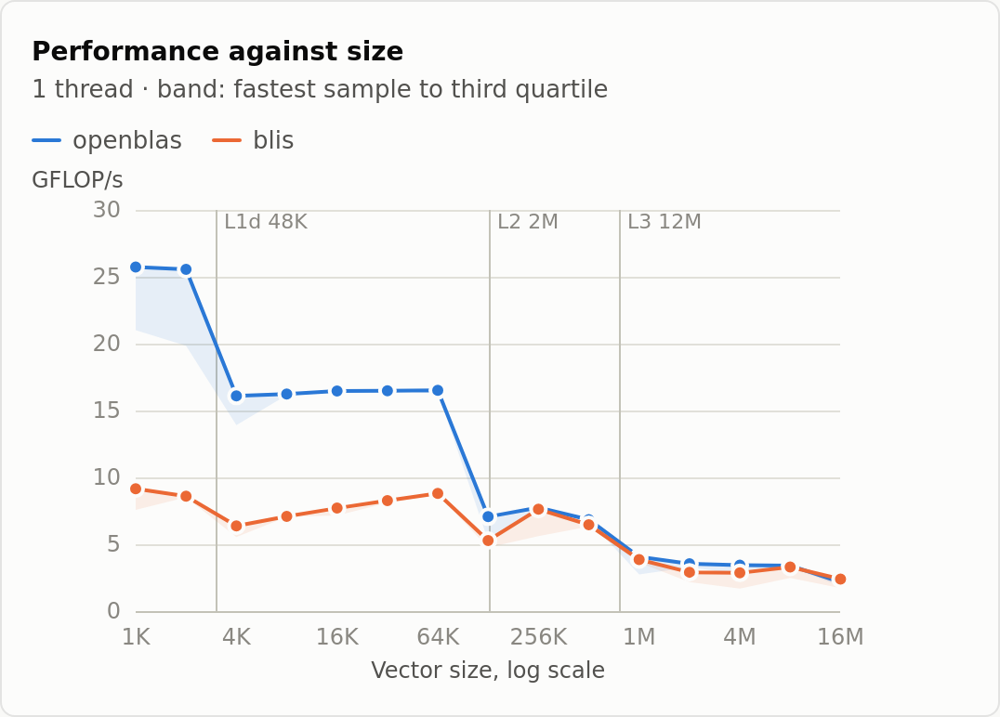
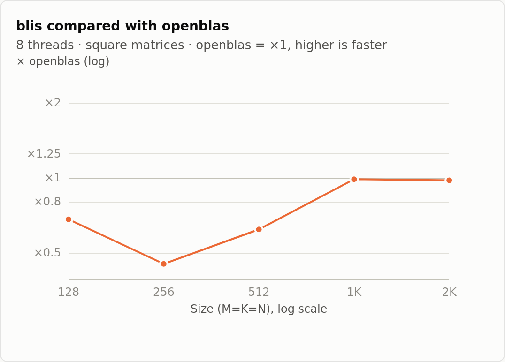
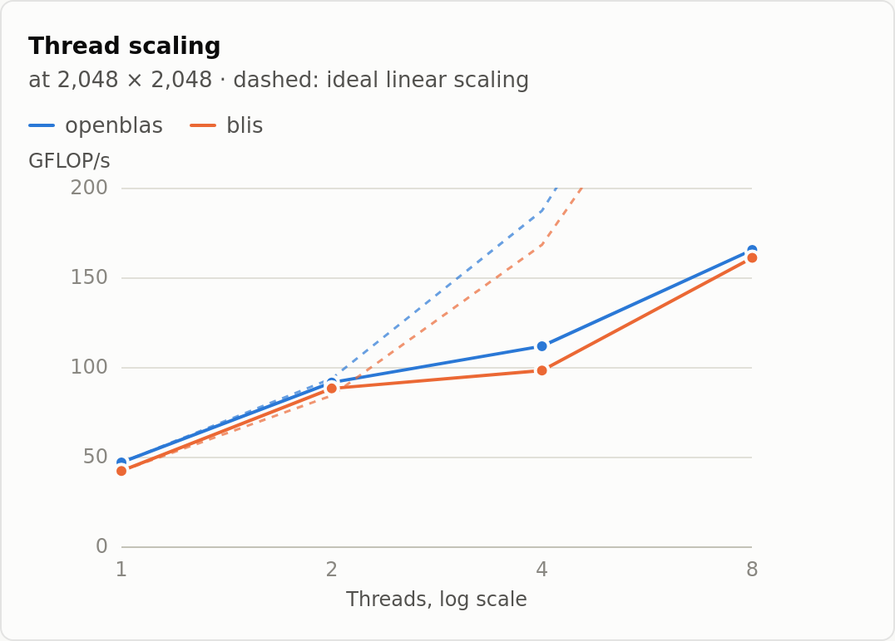
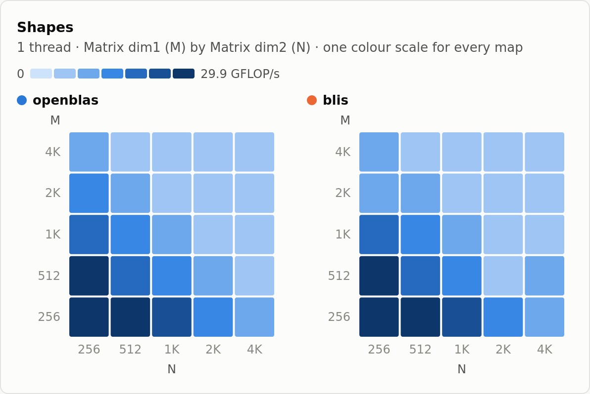

# blas-microbenchmark

[](https://github.com/MathieuCAISSA/blas-microbenchmark/actions/workflows/ci.yml?query=branch%3Amain)
[](https://codecov.io/gh/MathieuCAISSA/blas-microbenchmark)
[](https://scorecard.dev/viewer/?uri=github.com/MathieuCAISSA/blas-microbenchmark)
[](https://mathieucaissa.github.io/blas-microbenchmark/)
[](LICENSE)

Command-line microbenchmarks for BLAS routines: one small executable per
routine, the same options for all of them, and results in text, CSV or
JSON — [osu-micro-benchmarks](https://mvapich.cse.ohio-state.edu/benchmarks/),
but for BLAS instead of MPI.

Build it against OpenBLAS, BLIS, AMD AOCL-BLAS, Netlib reference BLAS, NVPL,
ArmPL or Intel MKL — or once against FlexiBLAS, which picks the library at run time — run the
same commands on each, and compare them on one page of charts.

## Install

You need a C compiler (GCC ≥ 12) and a BLAS library — at minimum OpenBLAS
(`libopenblas-dev` on Debian/Ubuntu). Take
**`blas-microbenchmark-<version>.tar.gz`** from the
[latest release](https://github.com/MathieuCAISSA/blas-microbenchmark/releases/latest):

```bash
tar xf blas-microbenchmark-<version>.tar.gz
cd blas-microbenchmark-<version>
./configure            # --prefix=DIR to install elsewhere than /usr/local
make
make check
make install
```

To check the download came from this repository's release workflow,
untouched (needs the [GitHub CLI](https://cli.github.com/)):

```bash
gh attestation verify blas-microbenchmark-<version>.tar.gz --repo MathieuCAISSA/blas-microbenchmark
```

From a git clone, run `./autogen.sh` first (it needs autoconf, automake
and libtool); GitHub's *"Source code"* archives are git clones too.

`make install` puts `bmb_report` in `/usr/local/bin`, the manual pages in
`/usr/local/share/man`, and the benchmarks by BLAS level under
`/usr/local/libexec/blas-microbenchmark` — not on the `PATH`. To run them
by name:

```bash
BMB=/usr/local/libexec/blas-microbenchmark
export PATH="$BMB/level1:$BMB/level2:$BMB/level3:$PATH"
```

On a cluster, `configure` finds a BLAS loaded with `module load` through
the variables the module sets (`OPENBLAS_ROOT`, `BLIS_INCDIR`,
`ARMPL_LIBDIR`, …); otherwise point at it with `--with-blas-incpath=DIR`
and `--with-blas-libpath=DIR`.

With Spack, which picks the BLAS (`^openblas`, `^blis`, `^netlib-lapack`,
`^flexiblas`, `^nvpl-blas`, `^armpl-gcc`, `^intel-oneapi-mkl`, `^amdblis`):

```bash
spack repo add https://github.com/MathieuCAISSA/blas-microbenchmark.git
spack install blas-microbenchmark ^openblas
spack load blas-microbenchmark
```

In a container, with Docker: the image is built from a git clone,
against OpenBLAS, or the library that `BLAS_BACKEND` names (`blis`,
`netlib` or `mkl`). The benchmarks are on its `PATH`, and it writes to
`/results`, here the current directory:

```bash
docker build -f packaging/docker/Dockerfile --build-arg BLAS_BACKEND=openblas -t blas-microbenchmark .
docker run --rm --user "$(id -u):$(id -g)" -v "$PWD:/results" blas-microbenchmark bmb_dgemm -m 64:1024 -o dgemm.json
```

HPC sites run containers with Apptainer instead. Save the image where
Docker is, then convert it where Apptainer is, which writes in the current
directory as you:

```bash
docker save -o blas-microbenchmark.tar blas-microbenchmark
apptainer build blas-microbenchmark.sif docker-archive://blas-microbenchmark.tar
apptainer exec blas-microbenchmark.sif bmb_dgemm -m 64:1024 -o dgemm.json
```

A container runs on the host's CPU, which is what the results record. Docker's
`--cpus` and `--cpuset-cpus` leave the benchmark fewer CPUs than it sees, and
`-t` beyond those gets a warning. Docker Desktop runs containers in a virtual
machine, whose own limits the numbers include.

Sites that test their systems with [ReFrame](https://reframe-hpc.readthedocs.io/)
can run every benchmark as a ReFrame test, with their own references:
see [packaging/reframe](packaging/reframe/README.md).

## Quick start

```
$ bmb_dgemm -m 512:2048
# blas-microbenchmark 1.5.0
# backend: openblas (OpenBLAS 0.3.26 NO_LAPACKE DYNAMIC_ARCH NO_AFFINITY Haswell MAX_THREADS=64)
# verified: every point, against a reference, before it was timed
# layout: row-major
# cpu: Intel(R) Core(TM) Ultra 7 155U (14 logical CPUs, 1 NUMA node)
# caches: L1d 48K, L1i 64K, L2 2M, L3 12M
# os: Linux 6.6.87.1-microsoft-standard-WSL2 x86_64
# date: 2026-10-15T08:47:16Z
# routine: dgemm
Thread count    Matrix dim1 (M=K)   Matrix dim2 (N)     time [s]        GFLOP/s
1               512                 512                 0.005236549     51.262
1               1024                1024                0.045034862     47.685
1               2048                2048                0.364057654     47.190
```

There are 32 benchmarks, `bmb_<routine>`, covering levels 1 to 3:
`dasum` `daxpy` `dcopy` `ddot` `dnrm2` `dscal` `dswap`, `dgemv` `dger`
`dsymv` `dsyr` `dsyr2` `dtrmv` `dtrsv`, `dgemm` `dsymm` `dsyrk` `dsyr2k`
`dtrmm` `dtrsm` in double precision; `saxpy` `sdot` `sgemv` `sgemm`
`strsm` `ssyrk` in single; `cgemm` `zgemm` `ztrsm` in complex, and the
complex-only `zdotc` `zherk` `zhemm`. They all take the same options: sizes to sweep
(`-v`, `-m`, `-M`), thread counts (`-t`), a file to save to (`-o`). Each
point is checked against a reference before it is timed, so a library
that computes the wrong thing stops the run instead of looking fast
(`-C` skips the check).
`bmb_dgemm --help` lists them, and
**`man blas-microbenchmark`** explains everything: sweeps, how a number is
measured, threads and NUMA, the output formats.

## Charts: `bmb_report`

```bash
bmb_ddot  -v 1024:16777216           -o results/ddot-openblas.json
bmb_dgemm -m 128:2048 -t 1:8         -o results/dgemm-openblas.json
bmb_dgemv -m 256:4096 -M 256:4096    -o results/dgemv-openblas.json
# ... the same three from a build against BLIS, as *-blis.json
bmb_report results/*.json > report.html
firefox report.html
```

The page is a single self-contained file — nothing is fetched, so it opens
without a network and can be sent as is. It shows performance against
size with the caches marked, each library compared with OpenBLAS, thread
scaling, a heatmap for sweeps over both dimensions, and the raw data.
Run each command several times, into separate files, and it shows how
far the runs spread and tells which differences are beyond that noise;
`man bmb_report` has the details.

<p>
<picture>
  <source media="(prefers-color-scheme: dark)" srcset="doc/images/ddot-size-dark.png">
  
</picture>
<picture>
  <source media="(prefers-color-scheme: dark)" srcset="doc/images/dgemm-ratio-dark.png">
  
</picture>
<picture>
  <source media="(prefers-color-scheme: dark)" srcset="doc/images/dgemm-threads-dark.png">
  
</picture>
<picture>
  <source media="(prefers-color-scheme: dark)" srcset="doc/images/dgemv-shapes-dark.png">
  
</picture>
</p>

*The commands above, run on a laptop (Intel Core Ultra 7 155U, WSL2)
against OpenBLAS 0.3.26 and BLIS 0.9.0: what the page draws, not a verdict
on either library.*

## Backends

Chosen when building, and each one built and tested in CI:

| Backend | `configure` flag |
| --- | --- |
| OpenBLAS *(default)* | *(none)* |
| BLIS | `--with-blas-backend=blis` |
| AMD AOCL-BLAS | `--with-blas-backend=aocl` |
| Netlib reference | `--with-blas-backend=netlib` |
| NVPL *(aarch64)* | `--with-blas-backend=nvpl` |
| ArmPL *(aarch64)* | `--with-blas-backend=armpl` |
| FlexiBLAS | `--with-blas-backend=flexiblas` |
| Intel MKL | `--with-blas-backend=mkl` |

With FlexiBLAS, one build measures every library it can load:
`FLEXIBLAS=BLIS-OPENMP bmb_dgemm …`, and each comes out as its own
series in the report. Fedora packages it; Debian and Ubuntu do not.

## Documentation

The manual pages, also online at
**[mathieucaissa.github.io/blas-microbenchmark](https://mathieucaissa.github.io/blas-microbenchmark/)**:

- `man blas-microbenchmark` (also `man bmb_dgemm`, and so on) — the
  benchmarks.
- `man bmb_report` — the report.
- [What they produce](https://mathieucaissa.github.io/blas-microbenchmark/outputs.html):
  the table, CSV and JSON of a run, and the report's summary, charts,
  repeated runs and raw data.
- Before installing, from the build directory: `man -l man/blas-microbenchmark.1`.
- [Development](https://mathieucaissa.github.io/blas-microbenchmark/development.html):
  every test and what CI runs.
- [CHANGELOG.md](CHANGELOG.md) — what changed in each release.
- The [wiki](https://github.com/MathieuCAISSA/blas-microbenchmark/wiki):
  results measured on real machines, with their files, and a FAQ.
- The [roadmap](https://github.com/users/MathieuCAISSA/projects/1): what
  is planned, in progress and done.
- [CONTRIBUTING.md](CONTRIBUTING.md), then [AGENTS.md](AGENTS.md) and
  the files in [doc/dev/](doc/dev/) it points to — for contributors:
  building from git, the tests, adding a routine, CI, cutting a release.

## Citing

If you use it in published work, please cite it: GitHub's *Cite this
repository* button gives the reference, from [CITATION.cff](CITATION.cff).

## License

[Apache License 2.0](LICENSE).
